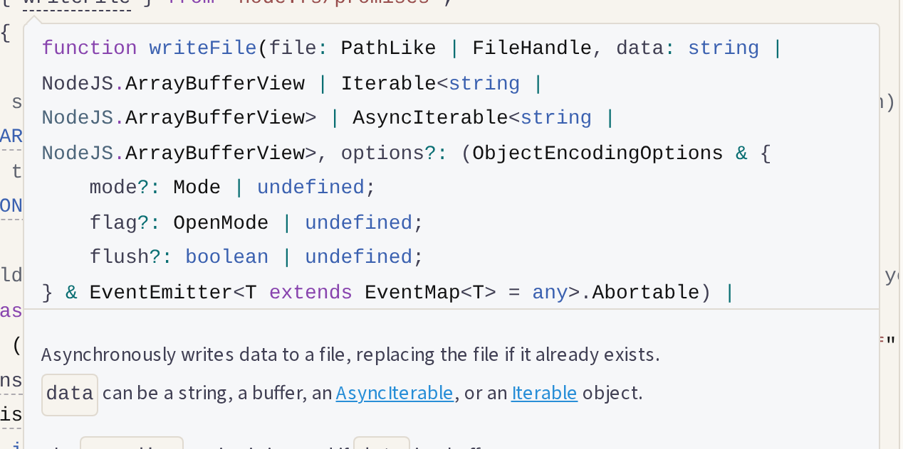
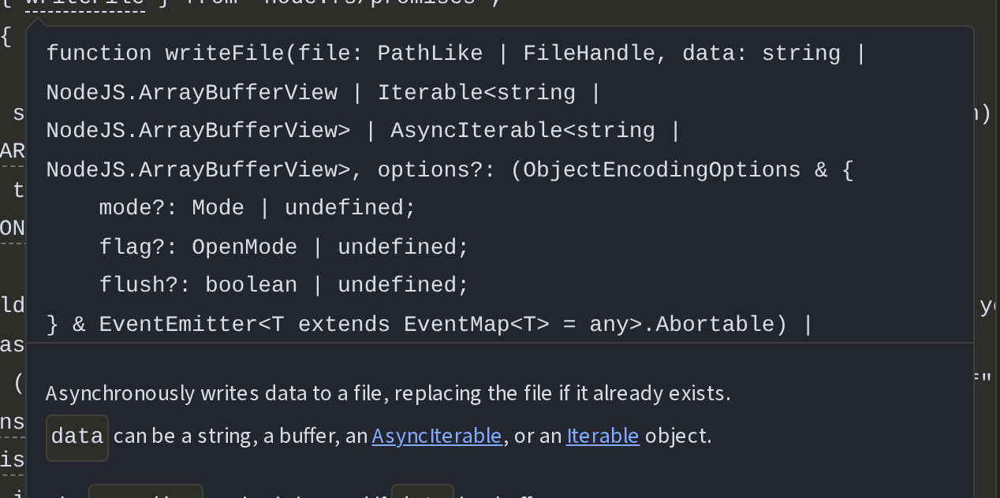

# Spike: `docs-twoslash` (Round Q4p)

- **Date:** 2026-11-12
- **Status:** done. Recommendation: keep Twoslash out of the docs site.
- **Plan:** [docs redesign §5](../../docs/plans/docs-redesign.md#5-out-of-scope)
- **Todo:** [Q4p](../../docs/todos/done/Q4p-twoslash-spike.md)
- **Code:** throwaway. A patch against the docs site and a measuring script; nothing ships.

## Question

What do Twoslash hover types cost the docs site, and what do readers get for it? The docs plan left Twoslash out on a guess that it "would add script and inline styles to every code block". This spike puts it on one page, "Your first PDF" in TypeScript, and measures the cost.

## Answer in one paragraph

**Keep it out.** The plugin works, but only outside the versions it supports, and its cost lands on every page. It also gives keyboard and screen-reader users nothing. Its script and styles grow the code-block files that all 425 pages load. Expressive Code's JavaScript grows from 2.5 KB to 27.1 KB, and its CSS from 18.3 KB to 33.8 KB, even on pages without a single hover. On the one page that has them, the HTML nearly doubles (97.5 KB to 183 KB), and the `style=` attributes grow from 278 to 1,231. The site's CSP with no `'unsafe-inline'` blocks every one of them, as it blocks Expressive Code's own. Hovers open by mouse in all three browsers and never by keyboard. Touch works in Firefox and WebKit but not Chromium, and the popups are hidden from screen readers. The safety argument, that a renamed API fails the docs build, holds but adds nothing here. The docs have no TypeScript code typed inline: all 50 code examples come from example files that `cargo xtask check ts` already type-checks.

## The plugin

[`expressive-code-twoslash`](https://www.npmjs.com/package/expressive-code-twoslash) 0.6.1 (MIT, 14 March 2026) is the only Twoslash plugin for Expressive Code, which Starlight's code blocks use. It declares `expressive-code ^0.41.7` and `typescript ^5.5.0` as peers. The docs site has Expressive Code 0.44.3 (Starlight 0.42.8) and TypeScript 6.0.3.

- `npm install` refuses it (`ERESOLVE`, peer `expressive-code@^0.41.7`). pnpm installs it with peer warnings and a second copy of `@expressive-code/core` (0.41.7) beside Starlight's 0.44.3.
- It needs Expressive Code's options in `ec.config.mjs`. Starlight's `<Code>` component, which `Snippet.astro` uses, can't read plugin objects from `astro.config.mjs`.
- With those two changes it builds and hovers work, against TypeScript 6.0.3 (the version pnpm resolves for `apps/docs`).

**Licences ([ADR 0019](../../docs/decisions/0019-supply-chain-and-licence-hygiene.md)).** The plugin brings 145 packages. 144 are under licences on `deny.toml`'s allow-list: 135 MIT, 4 ISC, 3 BSD and 2 Apache-2.0. The other is `minimatch` 10.2.6 under BlueOak-1.0.0, a permissive licence not on the list. It would be a dev-only dependency, which `cargo xtask npm-licenses` reports but doesn't block, and the lockfile already holds `minimatch` 10.2.6 through another package.

## Measurements

"Your first PDF" (`/start/first-pdf/`), built with and without the plugin from the same checkout (`twoslash.patch`, `LAMINA_PDF_TWOSLASH=1`). `measure.mjs` loads it in Chromium, Firefox and WebKit, in light and dark themes, under two CSPs:

- **Current:** the site's policy from `_headers`, with `style-src 'self' 'unsafe-inline'`.
- **Target:** the same policy without `'unsafe-inline'`, which Q4i will set.

The local copies leave out `upgrade-insecure-requests`, which would send the local server's files to `https` in WebKit. The full reports are `report-without.json` and `report-with.json`.

| | Without | With Twoslash |
| --- | ---: | ---: |
| Page HTML, raw / gzip | 97,503 / 16,038 B | 182,963 / 24,113 B |
| `style=` attributes in the HTML | 278 | 1,231 |
| Inline `<style>` / `<script>` blocks | 3 / 13 | 3 / 13 |
| JavaScript the page loads, raw / gzip (6 files) | 8,829 / 4,360 B | 33,380 / 13,196 B |
| CSS the page loads, raw / gzip (3 files) | 119,741 / 22,413 B | 135,216 / 24,517 B |
| Expressive Code's own files, loaded by every page | JS 2,523 B, CSS 18,292 B | JS 27,074 B, CSS 33,767 B |
| Files from another origin | none | none |
| Whole-site build, median of 3 | 17.9 s | 19.6 s |
| Hover tokens on the page | — | 49 |

**The CSP.** Under the current policy no browser reports a violation, in either theme. Under the target, both builds violate `style-src-attr` and `style-src-elem` in every browser. Expressive Code colours tokens with `style=` attributes already, so Q4i has that work to do either way. With Twoslash, both the code and the popups lose their colours (screenshots). The popups still stay hidden until a hover and open on one, since the plugin's script sets their `display` through the DOM, which the CSP allows.

**Build time.** One page with one code block adds 1.7 s (10%) to the whole build. Each block is type-checked by the TypeScript compiler, so the cost grows with the number of blocks.

## What readers get

| | Chromium | Firefox | WebKit |
| --- | --- | --- | --- |
| Mouse hover | opens | opens | opens |
| Keyboard (Tab through the page) | never | never | never |
| Touch (tap a token) | nothing | opens | opens |
| Light and dark themes | both | both | both |

- **Keyboard:** no token takes focus (no `tabindex`), and each popup is `tabindex="-1"`.
- **Screen readers:** each popup is `role="tooltip"` with `aria-hidden="true"`, so it is hidden from the accessibility tree, and the `aria-describedby` that points at it sits on a span that can't take focus. A screen reader reads the code as it does today and nothing more. This comes from the markup and the accessibility attributes, not a test with a screen reader.
- **What the hovers hold:** the first token on the page is `writeFile`, from Node, and its popup is a long signature with Node's own documentation. Many of the 49 hovers are Node and TypeScript built-ins rather than the SDK's types.





## A renamed type

Renaming `BuilderOptions` in `@laminapdf/sdk`'s exports (`src/api.ts`) and rebuilding its types:

- the docs build with Twoslash fails: `[2724] '"@laminapdf/sdk"' has no exported member named 'BuilderOptions'. Did you mean 'BuildOptions'?`;
- the docs build without it passes;
- `tsc --noEmit` in `packages/sdk`, part of `cargo xtask check ts`, fails on the same line of `examples/quick-start/node.ts`.

The docs show code only from tested example files (`Snippet.astro`, 50 uses), and no `.mdx` page has a TypeScript block written inline. CI already catches a stale type in the code the docs show.

## Recommendation

**Keep Twoslash out of the docs site.** Revisit it only when all three hold:

1. the plugin supports the Expressive Code and TypeScript versions Starlight ships;
2. Q4i's class-based token colours cover its tokens and popups;
3. its tokens take keyboard focus and its popups reach screen readers.

Even then, it would add 24.5 KB of script and 15.5 KB of CSS to every page, for hovers that mostly show Node's types. A cheaper way to show readers what `Builder` and the option objects hold: link the names in the prose to their TypeDoc pages, and the usage pages Q4o plans.

## How to run it

```sh
git apply spikes/docs-twoslash/twoslash.patch
pnpm install --no-frozen-lockfile                       # the plugin; peer warnings expected
cargo xtask wasm                                        # the SDK's types, which the hovers read
pnpm --filter @laminapdf/docs build                     # without
LAMINA_PDF_TWOSLASH=1 pnpm --filter @laminapdf/docs build   # with
cp spikes/docs-twoslash/measure.mjs apps/docs/          # so it finds the workspace's Playwright
cd apps/docs && pnpm exec playwright install chromium firefox webkit
SHOTS=/tmp/shots node measure.mjs dist > report.json
```
